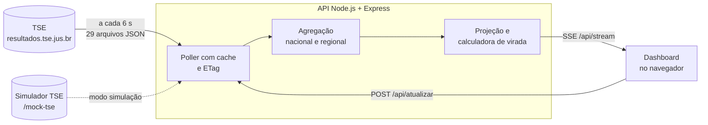

# Apuração Presidencial em Tempo Real (dados do TSE)


Aplicação web local que acompanha a apuração da eleição para **Presidente da República** em tempo real,
lendo os arquivos JSON públicos do **TSE** (Tribunal Superior Eleitoral). Uma API em Node.js consulta o TSE
a cada 6 segundos, consolida os dados nacionais, estaduais e regionais, calcula projeções e envia tudo para
um dashboard no navegador.

Funciona com os dados oficiais das **Eleições 2026** (1º e 2º turno) e tem um **modo simulação** para testar
a interface a qualquer momento, mesmo fora do período eleitoral.

> Painel **não oficial**, feito para acompanhamento. O resultado oficial é o divulgado pelo TSE.

---

## Funcionalidades

**Apuração nacional**
- Percentual de urnas (seções) apuradas no Brasil.
- Votos válidos, brancos, nulos e abstenções, com os percentuais.
- Candidatos com foto, número, partido, coligação e vice, ordenados automaticamente do mais para o menos votado
  (a troca de posição é animada).
- Barra proporcional da disputa e diferença total de votos entre 1º e 2º colocados.

**Visão por região e por estado**
- Mapa do Brasil interativo em SVG (malha oficial do IBGE), com as 27 UFs agrupadas nas 5 regiões.
- Três modos de cor: **Regiões**, **Urnas apuradas** (escala por % apurado) e **Líder por UF**.
- Cartão em cada região com % apurado e os 2 candidatos líderes; tooltip com detalhes do estado e da região.
- Clique numa região para ver a tabela com todos os estados.

**Projeções e virada**
- Projeção do resultado final por dois métodos (ritmo atual de cada UF e 1º turno + variação observada).
- Calculadora de virada: % que o 2º colocado precisa dos votos restantes, % que está recebendo, diferença em
  pontos percentuais, diferença projetada no final e contribuição de cada estado.
- Selo "Matematicamente definido" quando a vantagem supera todos os eleitores das seções que faltam.

**Atualização e resiliência**
- Atualização automática a cada 6 s, com contagem regressiva, contador de atualizações automáticas e manuais
  e botão **Atualizar** para buscar na hora.
- Falhas de rede, timeouts e respostas 404/503 não apagam a tela: o painel mantém o último dado válido de cada
  arquivo e mostra um aviso com o que falhou.
- Tema escuro por padrão (estilo dashboard de cobertura jornalística), tema claro opcional e layout responsivo.

---

## Tecnologias

| Camada | Tecnologia | Uso |
|---|---|---|
| Backend | **Node.js** (≥ 18.17) | `fetch` nativo, `AbortSignal.timeout`, sem dependências além do Express |
| Backend | **Express 4** | API REST, Server-Sent Events, arquivos estáticos e simulador do TSE |
| Frontend | **HTML5 + JavaScript puro** | Renderização sem framework, atualização incremental do DOM |
| Frontend | **Tailwind CSS 3** (CDN) | Layout, tema escuro/claro e responsividade |
| Frontend | **SVG** | Mapa do Brasil interativo e gráficos (barras, réguas, barras divergentes) |
| Dados | **API pública do TSE** | Resultados por Brasil, UF e exterior (`resultados.tse.jus.br`) |
| Dados | **API de malhas do IBGE** | Contornos dos estados, convertidos em SVG por um script próprio |
| Tempo real | **Server-Sent Events (SSE)** | O servidor envia cada atualização ao navegador, com polling como reserva |

---

## Arquitetura



- **Polling resiliente** ([server/tse.js](server/tse.js)): busca em paralelo o arquivo nacional, os das 27 UFs
  e o do exterior, com timeout de 5 s. Cada arquivo tem cache próprio e as requisições usam `If-None-Match`
  (ETag), então arquivos sem mudança voltam como `304` sem corpo. Se a CDN devolver uma cópia mais antiga,
  ela é ignorada (o número de seções totalizadas nunca regride).
- **Agregação regional** ([server/agregacao.js](server/agregacao.js)): o TSE não publica arquivos por região.
  A % apurada de cada região é `soma(seções totalizadas) ÷ soma(seções)` das suas UFs, e o percentual de cada
  candidato é `soma(votos) ÷ soma(válidos)`.
- **Projeção** ([server/projecao.js](server/projecao.js)):
  - *Ritmo atual de cada UF*: votos restantes da UF = (válidos apurados ÷ seções apuradas) × seções que faltam,
    divididos como os votos já apurados ali.
  - *1º turno + variação* (só no 2º turno real): resultado do 1º turno em cada UF somado à variação média
    observada até o momento.
  - *Virada*: necessário = `50% + vantagem ÷ (2 × votos restantes)`, comparado com a fatia que o 2º colocado
    está recebendo, ponderada pelo que falta em cada UF.
- **Simulador** ([server/mock.js](server/mock.js)): gera arquivos no mesmo formato do TSE com apuração
  progressiva, candidatos fictícios, viradas e falhas de rede propositais. O poller consulta o simulador pelo
  mesmo caminho de código usado com o TSE real.

---

## Endpoints da API local

| Método | Rota | Descrição |
|---|---|---|
| `GET` | `/api/apuracao` | Snapshot completo: status, visão nacional, regiões, estados e projeção |
| `GET` | `/api/stream` | Server-Sent Events: envia o snapshot a cada ciclo de atualização |
| `POST` | `/api/atualizar` | Busca os dados do TSE imediatamente e reinicia a contagem da atualização automática |
| `POST` | `/api/mock/reset` | (modo simulação) Reinicia a apuração simulada do zero |
| `GET` | `/mock-tse/oficial/ele{ano}/{eleicao}/dados/{uf}/{uf}-c0001-e{eleicao}-u.json` | (modo simulação) Arquivos no formato do TSE |

Resumo do snapshot (`/api/apuracao`):

```jsonc
{
  "meta":     { "modo": "tse", "ano": "2026", "eleicao": "6258", "intervaloMs": 6000 },
  "status":   { "ok": true, "arquivos": { "total": 29, "ok": 29 }, "erros": [],
                "atualizacoes": { "auto": 12, "manual": 1 }, "proximaAutomatica": "..." },
  "nacional": { "secoes": { "pct": 67.06 }, "validos": {...}, "brancos": {...}, "nulos": {...},
                "abstencao": {...}, "candidatos": [ { "nome": "...", "votos": 0, "pct": 0 } ] },
  "regioes":  [ { "id": "nordeste", "secoes": {...}, "candidatos": [...], "estados": [...] } ],
  "projecao": { "metodos": [...], "virada": { "precisaPct": 52.1, "recebePct": 48.25, "estados": [...] } }
}
```

---

## Fonte dos dados (TSE)

O índice de eleições fica em `https://resultados.tse.jus.br/oficial/comum/config/ele-c.json`. Para 2026,
Presidente tem os códigos **6257** (1º turno) e **6258** (2º turno).

```
https://resultados.tse.jus.br/oficial/ele2026/6258/dados/br/br-c0001-e006258-u.json   ← Brasil
https://resultados.tse.jus.br/oficial/ele2026/6258/dados/sp/sp-c0001-e006258-u.json   ← cada UF (27)
https://resultados.tse.jus.br/oficial/ele2026/6258/dados/zz/zz-c0001-e006258-u.json   ← exterior
https://resultados.tse.jus.br/oficial/ele2026/6258/fotos/br/{sqcand}.jpeg              ← fotos
```

`c0001` é o cargo de Presidente e o código da eleição vai com 6 dígitos. Em 2022 o TSE usava
`dados-simplificados/...-r.json`; em 2026 o arquivo equivalente é o `-u.json` na pasta `dados/`.

| Campo | Significado |
|---|---|
| `t`, `tf` | Turno; `tf = "s"` quando a totalização terminou |
| `dt`, `ht` | Data e hora da última totalização |
| `s.ts`, `s.st`, `s.pst` | Seções totais, totalizadas e % totalizado |
| `e.te`, `e.est`, `e.c`, `e.a` | Eleitorado total, eleitorado apurado, comparecimento, abstenções |
| `v.tv`, `v.vv`, `v.vb`, `v.tvn` | Votos totais, válidos, brancos e nulos |
| `carg[0].agr[].par[].cand[]` | Candidatos, agrupados por coligação (`agr`) e partido (`par`) |
| `cand.nmu`, `cand.n`, `cand.vap`, `cand.pvap`, `cand.st` | Nome de urna, número, votos, % dos válidos, situação |

Exemplos completos no formato do TSE estão em [mock/](mock/).

**Sobre o intervalo de 6 s:** os arquivos são servidos por uma CDN (Akamai) que guarda cada cópia por
40 a 60 segundos, com servidores renovando em momentos diferentes. Consultar a cada 6 s pega cedo o servidor que
renovou primeiro, sem gerar volume que arrisque bloqueio (cerca de 5 requisições por segundo, a maioria `304`).

---

## Como rodar

Pré-requisito: [Node.js](https://nodejs.org) 18.17 ou mais recente.

```bash
git clone https://github.com/hugonn/IA-Projects.git
cd IA-Projects/apuracao-presidencial-tse
npm install
```

```bash
npm run mock      # simulação: funciona a qualquer momento
npm start         # dados oficiais do TSE (2º turno 2026)
```

Abra **http://localhost:3000**. Para parar, `Ctrl + C`.

| Comando | O que faz |
|---|---|
| `npm start` | TSE oficial, 2º turno 2026 (eleição `6258`) |
| `npm run start:1turno` | TSE oficial, 1º turno 2026 (eleição `6257`) |
| `npm run mock` | Simulação do 1º turno com 8 candidatos fictícios (apuração completa em 8 min) |
| `npm run mock:2turno` | Simulação de 2º turno |
| `npm run dev` | Simulação reiniciando o servidor quando o código muda |
| `npm test` | Roda os testes automatizados |
| `npm run mapa` | Baixa a malha do IBGE e regenera `public/mapa-brasil.js` |

### Configuração

Passe as opções depois de `--` (ex.: `npm run mock -- --duracao=3 --falhas=0.2`) ou como variáveis de ambiente.

| Argumento | Variável | Padrão | Descrição |
|---|---|---|---|
| `--porta=` | `PORT` | `3000` | Porta do painel |
| `--ano=` | `ANO` | `2026` | Ciclo eleitoral |
| `--turno=` | `TURNO` | `2` (real) / `1` (mock) | Escolhe o código da eleição |
| `--eleicao=` | `ELEICAO` | `6258` | Código da eleição no TSE (sobrepõe `--turno`) |
| `--intervalo=` | `INTERVALO_MS` | `6000` | Intervalo de consulta em ms |
| `--timeout=` | `TIMEOUT_MS` | `5000` | Tempo máximo por requisição |
| `--tse=` | `TSE_BASE_URL` | `https://resultados.tse.jus.br` | Servidor de origem |
| `--mock` | `MODO_MOCK=true` | — | Liga a simulação |
| `--duracao=` | `MOCK_DURACAO_MIN` | `8` | Minutos até a simulação chegar a ~100% |
| `--falhas=` | `MOCK_FALHAS` | `0.04` | Fração de respostas 503/timeout simuladas |

---

## Testes

### Testes automatizados

Usam o test runner nativo do Node.js (`node:test`), sem dependências extras e sem acesso à internet:

```bash
npm test
```

| Arquivo | O que verifica |
|---|---|
| [tests/tse.test.js](tests/tse.test.js) | Montagem das URLs do TSE, conversão de números com vírgula, leitura do `-u.json`, ordenação dos candidatos e rejeição de respostas inválidas |
| [tests/mock.test.js](tests/mock.test.js) | Simulador: arquivo nacional igual à soma das UFs, votos e seções nunca diminuem, totalização final com situação definida, 2º turno com dois candidatos |
| [tests/projecao.test.js](tests/projecao.test.js) | Projeção e calculadora de virada contra um cenário calculado à mão (% necessário, % recebido, margem final), "matematicamente definido" e agregação regional |

Resultado atual: **13 testes, 13 passando**.

### Testes manuais e de integração

Feitos contra o TSE real, o simulador e o navegador (desktop e celular), durante a apuração do
2º turno de 25/10/2026.

#### Integração com o TSE

| Teste | Resultado |
|---|---|
| Descoberta dos códigos da eleição em `ele-c.json` | 2026: 6257 (1º turno) e 6258 (2º turno) confirmados |
| Formato das URLs `dados/{uf}/{uf}-c0001-e{eleicao}-u.json` | 200 para BR, 27 UFs e exterior; `dados-simplificados` (formato 2022) retorna 404 |
| Fotos dos candidatos `fotos/br/{sqcand}.jpeg` | 200 (`.jpg` retorna 404) |
| Leitura do 1º turno já totalizado | Números iguais aos oficiais (47,03% × 45,16%), 100% apurado, situação "2º turno" |
| Agregação por região com dados reais | 5 regiões calculadas a partir das UFs, sem UFs faltando |
| Ciclo completo de busca | 29/29 arquivos OK por ciclo |
| 2º turno antes do fechamento das urnas | Arquivos zerados tratados; status "Aguardando apuração" |
| 2º turno durante a apuração | Atualização ao vivo acompanhada de ~50% a ~67% das seções |
| Cabeçalhos de cache e limite | CDN Akamai com `max-age` de 40 a 60 s; `X-RateLimit` não é por cliente |

#### Resiliência

| Teste | Resultado |
|---|---|
| Servidor do TSE inacessível (host inválido) | Erro `ENOTFOUND` exibido, nova tentativa a cada ciclo, sem travar |
| Respostas 503 e timeouts simulados | Aviso amarelo com os arquivos que falharam; último dado válido mantido |
| Porta já em uso | Mensagem clara com sugestão de outra porta, em vez de stack trace |
| Cópia antiga entregue pela CDN | Ignorada: o total de seções totalizadas nunca regride |
| Atualização manual com ciclo em andamento | Reaproveita o ciclo em curso, sem duplicar requisições |

#### Cálculos

| Teste | Resultado |
|---|---|
| Projeção comparada com cálculo independente em script | Mesmos valores nos dois métodos |
| Calculadora de virada comparada com cálculo independente | % necessário, % recebido e contribuição por estado batem |
| Diferença de votos no card de candidatos × calculadora | Inconsistência encontrada (arquivos das UFs atualizam depois do BR) e corrigida: ambos usam o arquivo nacional |
| Projeção no 1º turno (simulação, 8 candidatos) | Indica vitória no 1º turno ou quem vai ao 2º turno |

#### Interface

| Teste | Resultado |
|---|---|
| Reordenação automática dos candidatos | Troca de posição animada observada durante a simulação |
| Mapa: hover, tooltip, clique e três modos de cor | Funcionando; tooltip limitado à área visível em telas estreitas |
| Botão Atualizar e contadores | Contador manual incrementa e a contagem regressiva reinicia |
| Celular (375 px) | Sem rolagem horizontal, após corrigir o grid |
| Tema claro e escuro | Ambos verificados; cor preta ganha contorno no tema escuro |
| Console do navegador | Sem erros de JavaScript |

#### Como reproduzir

```bash
npm run mock
```

```bash
curl -s http://localhost:3000/api/apuracao
```

```bash
curl -s -X POST http://localhost:3000/api/atualizar
```

Para testar a falta de conexão, aponte para um host inexistente:

```bash
npm start -- --tse=https://resultados.tse.invalid
```

---

## Estrutura do projeto

```
├── package.json
├── server/
│   ├── index.js        Express, rotas da API e inicialização
│   ├── config.js       Argumentos e variáveis de ambiente
│   ├── tse.js          URLs do TSE, parser do JSON e poller com cache
│   ├── agregacao.js    Visão nacional, regional e por estado
│   ├── projecao.js     Projeção do resultado e calculadora de virada
│   ├── regioes.js      UFs e regiões do IBGE
│   └── mock.js         Simulador no formato do TSE
├── public/
│   ├── index.html      Layout (Tailwind)
│   ├── app.js          Renderização, SSE, atualização manual e contadores
│   ├── mapa.js         Mapa do Brasil interativo
│   ├── mapa-brasil.js  Contornos SVG das UFs (gerado)
│   ├── util.js         Formatação pt-BR e cores dos candidatos
│   └── styles.css
├── scripts/
│   └── gerar-mapa.js   Gera mapa-brasil.js a partir da malha do IBGE
├── tests/              Testes automatizados (node:test)
├── mock/               Exemplos de JSON no formato do TSE
├── .editorconfig       Padrão de formatação (UTF-8, LF, 2 espaços)
├── .gitattributes      Normalização de finais de linha
└── .gitignore
```

---

## Observações

- Percentuais de candidatos são sobre votos válidos; brancos e nulos sobre o total de votos; abstenções sobre o
  eleitorado das seções já apuradas.
- As projeções são estimativas aritméticas simples: supõem que, dentro de cada estado, as seções que faltam votam
  como as já apuradas. Não são projeções estatísticas oficiais.
- Os candidatos do modo simulação são fictícios.
- Dados eleitorais: [TSE](https://resultados.tse.jus.br). Malha territorial: [IBGE](https://servicodados.ibge.gov.br/api/docs/malhas).
